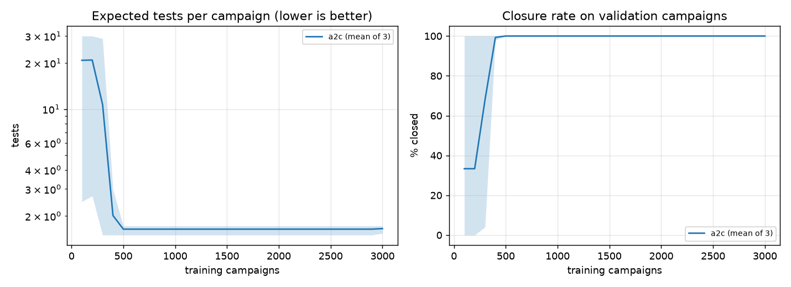
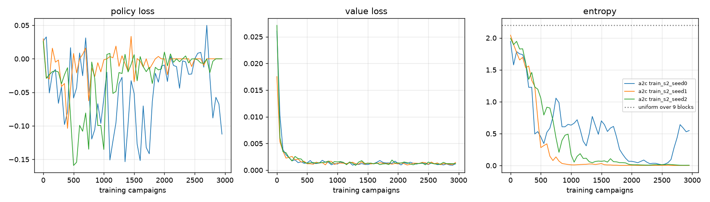

# A2C vs step-2 DDQN on the FIFO

Measured 2026-11-27. Agent: `fifo_rl/agents/a2c.py` (Contract F). Wiring and protocol: `fifo_rl/scripts/run_campaign.py`, plan: `A2C_PLAN.md`.

## 1. Short answer

- **A2C is more stable than DDQN.** All 3 seeds were at 100% closure by campaign 500 and never fell back after that (one seed wobbled once before campaign 300). `last.pt` is as good as `best.pt` (within 0.19 tests). Seed-to-seed spread is about 10× smaller (fake FIFO: ±0.05 tests vs ±0.44).
- **A2C trains about 10× faster.** 3,000 campaigns take ~5 minutes per seed on CPU. DDQN needs ~1 hour.
- **But A2C learns constrained random, not a strategy.** Played greedily, 2 of 3 seeds always play `BASELINE` ×10, which is exactly the constrained-random baseline. The third (seed 2) adds a few `WRITE` / `RAND50` blocks and is slightly better.
- **Result:** A2C equals or slightly beats constrained random and uses fewer tests than DDQN (1.70 vs 2.14 on the fake FIFO). It does **not** find the ordered, coverage-directed plan that DDQN seed 0 found, so on cycles DDQN's best is still lower.
- The cause is the reward, not the algorithm. With `cycle_cost: 0`, a full plan of `BASELINE` costs nothing extra, and it closes in ~1.7 tests. Nothing pushes toward a short, ordered plan.

## 2. Set-up (same conditions as DDQN)

| | Value |
|---|---|
| Actions / state | the same 9 blocks and 93-number state |
| Reward | step 2 (`--reward-mode action`), γ 0.99, `cycle_cost` 0 |
| A2C settings | `configs/default.yaml` defaults: `a2c_lr` 7e-4, `a2c_hidden` [128, 128], `ent_coef` 0.01, `vf_coef` 0.5, `gae_lambda` 0.95, `a2c_rollout_tests` 4, grad clip 0.5, Adam |
| Training | 3 seeds (0, 1, 2) × 3,000 campaigns on the fake FIFO, validation on 50 campaigns every 100 |
| Checkpoint rule | the new shared rule: fewest **expected tests** (a failed campaign counts as the full 30), then fewest cycles |
| Fake FIFO evaluation | 300 unseen campaigns (seed + 2000), plus the first 200 of them, which are the same set as the DDQN numbers |
| Questa evaluation | 10 campaigns, `--seed 0` for every agent (same campaigns as `final_cmp`), `FIFO_test` run on the same day |

The DDQN numbers come from `docs/random_vs_step1_vs_step2.md` (2026-11-18). Their checkpoints are not on this PC, so DDQN was **not** re-run here (see §6).

## 3. Fake FIFO

### 3.1 200 campaigns (directly comparable with the DDQN doc)

| Agent | Closed | Tests per campaign | Cycles per campaign |
|---|---|---|---|
| Random block each step | 98.5% | 8.86 | 459 |
| Step-2 DDQN (3 seeds) | 100% | 2.14 ± 0.44 | **260 ± 60** |
| Constrained random (always `BASELINE`) | 100% | 1.77 | 320 |
| **A2C, `best.pt`, greedy (3 seeds)** | **100%** | **1.73 ± 0.05** (1.77 / 1.74 / 1.68) | 300 ± 32 (320 / 315 / 263) |

### 3.2 300 campaigns, every way of playing it

Each baseline was run on the same 300 campaigns as each A2C seed. Values are the mean over seeds 0 / 1 / 2.

| Agent | Closed | Expected tests | Cycles |
|---|---|---|---|
| Random block each step | 99.1% | 8.90 | 462 |
| Constrained random (`BASELINE`) | 100% | 1.76 | 319 |
| A2C `best.pt`, greedy | 100% | **1.70** (1.72 / 1.73 / 1.64) | **294** (311 / 314 / 257) |
| A2C `last.pt`, greedy | 100% | 1.77 (1.75 / 1.73 / 1.83) | 315 (301 / 314 / 332) |
| A2C `best.pt`, sampled | 100% | 2.18 (2.30 / 1.74 / 2.51) | 295 (315 / 291 / 280) |
| A2C `last.pt`, sampled | 100% | 1.81 (1.87 / 1.73 / 1.83) | 318 (310 / 314 / 331) |

**The plans it plays** (greedy, `best.pt`, most common plan in the 300 campaigns):
- Seeds 0 and 1: `BASELINE` ×10 every time, the same as constrained random.
- Seed 2: `BASELINE BASELINE WRITE RAND50 BASELINE RAND50 BASELINE BASELINE WRITE RAND50` in its first test, then `BASELINE` ×10. That is the only seed that beats the baseline (1.64 tests, 257 cycles).
- The agent never chooses `END_TEST` itself: every plan is full (10 blocks), and `END_TEST` is forced.

**Sampled play** does not help. It cannot get stuck repeating `WRITE`, because A2C never learned that loop. It only adds noise to `BASELINE` plans, and with `best.pt` that costs up to 0.8 tests.

## 4. Stability (the main question)



- **Learning speed:** 100% validation for good from campaign 200 (seed 0), 500 (seed 1) and 300 (seed 2).
- **One early wobble, no late collapse:** seed 2 closed 100% at campaign 100, fell to 0% at campaign 200 (a stuck policy that used all 30 tests), then recovered by 300. After campaign 500, no seed's validation closure dropped below 100% in the remaining 2,500 campaigns, and expected tests stayed within 0.15 of each seed's best. DDQN's known collapse came **late** in training.
- **`last.pt` ≈ `best.pt`:** on 300 campaigns the gap is 0.03 / 0.00 / 0.19 tests. DDQN needed `best.pt` and its final weights could be much worse. A2C does not need that.
- **Spread over seeds:** ±0.05 tests (fake, 200 campaigns) and ±0.29 runs (Questa), vs ±0.44 and ±0.38 for DDQN.



- **Entropy** falls from ~2.0 (almost uniform over 9 blocks, ln 9 = 2.2) to ~0 for seeds 1 and 2 by campaign 2,000. Seed 0 stays around 0.5: its policy still hesitates between `BASELINE` and `WRITE` at some positions.
- **Value loss** drops to ~0.001 within 300 campaigns. The critic predicts the remaining reward almost exactly, because the outcome of `BASELINE` ×10 hardly varies.
- So the policy becomes deterministic. It is stable because it has settled on one plan, not because it keeps improving. With `ent_coef` 0.01 that happens by campaign ~1,000. Mohamed's earlier runs with `ent_coef` 0.05 and 0.1 found the same plan and trained less stably.

## 5. Real Questa (10 campaigns, same day)

| | Constrained random | **A2C (3 seeds)** | Step-2 DDQN (2026-11-18) | `FIFO_test` |
|---|---|---|---|---|
| Reached 64/64 | 10/10 | **30/30** | 30/30 | 10/10 |
| Questa runs per campaign | 2.0 | **1.83 ± 0.29** (2.0 / 2.0 / 1.5) | 2.17 ± 0.38 | 1 |
| Cycles needed | 362 | 318 ± 75 (362 / 362 / 232) | **273 ± 86** | 379 (275–538) |
| Cycles simulated | 362 | 318 | 273 | 10,200 |
| Wall time per campaign | 4.9 s | 4.4 ± 0.8 s (3.6 / 5.2 / 4.4) | 5.6 ± 0.9 s | **3.1 s** |

- The fake FIFO and Questa agree. Seeds 0 and 1 run the same plans as constrained random on Questa and get exactly the same runs and cycles (2.0, 362). Seed 2 is better (1.5 runs, 232 cycles).
- **Wall time is noise at this scale.** Seeds 0 and 1 simulated identical plans, yet took 3.6 s and 5.2 s per campaign. The constrained-random run's first test took 10.1 s (Questa warm-up). Compare runs and cycles, not seconds.
- `FIFO_test` (one long constrained-random run) is still the fastest in wall time, 3.1 s. That was expected (A2C_PLAN §8): one simulation beats two Questa start-ups on this easy covergroup.

## 6. Limits and open points

- **DDQN was not re-run on the same day.** Its checkpoints and `runs/campaign/` are only on Yasmeen's and Kenzy's PCs. The DDQN column comes from 2026-11-18. Runs and cycles are deterministic for a given plan and seed, so they compare directly; wall time does not.
- **DDQN was selected with the old rule** (closure first). The new rule could pick different DDQN checkpoints. A fair final table needs DDQN re-evaluated (or retrained, ~1 h per seed) with the new `score()`.
- **The reward allows `BASELINE` ×10.** To push A2C toward short, ordered plans, the team would need to decide on a non-zero `cycle_cost` or a per-test penalty. That changes the shared reward, so both agents must be retrained.
- **The sweep** (`ent_coef` {0, 0.01, 0.05}, `a2c_lr` {3e-4, 7e-4}, K {1, 4, 8}, `gae_lambda` {0.95, 1.0}) is the joint next step in the plan and has not been run. Given §4 (a deterministic `BASELINE` policy by campaign ~1,000), it is unlikely to change the conclusion without a reward change.

## 7. Reproduce (from `fifo_rl/`)

```bash
# train, 3 seeds (≈5 min each on CPU)
python -m scripts.run_campaign train --agent a2c --reward-mode action --gamma 0.99 --seed 0 \
       --n-campaigns 3000 --out runs/campaign/a2c/train_s2_seed0
# fake FIFO: greedy and sampled, best.pt and last.pt
python -m scripts.run_campaign eval --agent a2c --checkpoint runs/campaign/a2c/train_s2_seed0/best.pt \
       --eval-campaigns 300 --reward-mode action --seed 0 --out runs/campaign/a2c/evalfake300_best_seed0
python -m scripts.run_campaign eval --agent a2c --sample --checkpoint runs/campaign/a2c/train_s2_seed0/best.pt \
       --eval-campaigns 300 --reward-mode action --seed 0 --out runs/campaign/a2c/evalfake300_best_sampled_seed0
python -m scripts.run_campaign eval --agent baseline --eval-campaigns 300 --reward-mode action --seed 0 \
       --out runs/campaign/a2c/evalfake300_baseline_seed0
# Questa: same 10 campaigns (--seed 0) for every agent, one after another
python -m scripts.run_campaign eval --agent a2c --checkpoint runs/campaign/a2c/train_s2_seed0/best.pt \
       --launcher questa --questa-bin C:/questasim64_2024.1/win64 --eval-campaigns 10 --reward-mode action \
       --seed 0 --out runs/campaign/a2c_questa/a2c_seed0
python -m scripts.run_fifo_test 10 fifo_test_a2c_day
# plots
python -m scripts.plot_campaign runs/campaign/a2c/train_s2_seed* --out runs/campaign/a2c/plots
```

**Where the data is** (under `fifo_rl/`, git-ignored):

| What | Folder |
|---|---|
| Training runs | `runs/campaign/a2c/train_s2_seed{0,1,2}/` |
| Fake FIFO evaluations | `runs/campaign/a2c/evalfake{200,300}_{best,last}[_sampled]_seed*/`, `evalfake300_{baseline,random}_seed*/` |
| Questa | `runs/campaign/a2c_questa/{baseline,a2c_seed0,a2c_seed1,a2c_seed2}/`, `runs/questa/tests/fifo_test_a2c_day/` |
