# fifo_rl v2 — following the PPO campaign-controller architecture

Status 2026-10-25: **design proposal.** Update (same day): the orchestration path is now built for single-action plans — plan file, launcher interface + fake launcher, the three parsers → `RunResult`, `CampaignStore`, encode-only `StateEncoder` (see [`fifo_rl_class_diagram.md`](fifo_rl_class_diagram.md)); multi-item plans, the mask, per-item rewards and the trajectory builder are still to do. It maps the target architecture
(Campaign Store → State Encoder → Actor with legality mask → Plan Builder → Text Plan Writer →
Simulator Launcher → Result & Coverage Parser → Reward & Trajectory Builder → Rollout Buffer → PPO)
onto the code in `fifo_rl/`, says what exists and what is missing, and specifies the two big changes:
**one simulation runs a whole stimulus plan**, and **every action in the plan gets its own reward**.
The agent itself (actor, critic, rollout buffer, PPO optimizer) is out of scope here; only its interface is fixed.
The current code is described in [`fifo_rl_class_diagram.md`](fifo_rl_class_diagram.md).

> The architecture names the OpenTitan UART as the DUT; everything below applies it to the FIFO pilot.
> The design is DUT-independent except for the action vocabulary, the cycle model and the bin list.

---

## 1. Gap analysis: architecture block → what we have

✅ reuse as is · ✏️ exists, must change · 🆕 missing · ⏸ agent team (out of scope)

| Architecture block | Existing code | Status | What is missing / must change |
|---|---|---|---|
| **Campaign Store** (bins & history) | `StateEncoder._checklist` (cumulative bins), `EpisodeResult` / `CsvLogger` (history) | ✏️ | Storage is mixed into the state encoder. Needs its own `CampaignStore`: covered bins, *which plan and item first hit each bin*, history of every plan run, runs left. |
| **State Encoder** | `state.py` `StateEncoder` (64 bins + budget + one-hot of 22 actions = 87) | ✏️ | Must read from the Campaign Store, and add the *plan-so-far context* (items used, cycles used, expected FIFO level, last item). New size 93 (§3.3). |
| **Legality Mask Builder** | — | 🆕 | `LegalityMaskBuilder`: which actions are allowed at this point of the plan (§3.4). |
| **Actor (masked categorical)** | DDQN in progress (Contract E) | ⏸ | Interface needed: `act(state, mask) → (action, log_prob)`. |
| **Critic V(S_t)** | — | ⏸ | Interface needed: `value(state) → float`. |
| **Plan Builder** (iterates until END_TEST) | `actions.py`: one `ActionSpec` = one whole self-contained run | 🆕 | `PlanBuilder` asks the actor for items one at a time until END_TEST or a limit, and records (S_t, A_t, log π, V) of each item. |
| **Action vocabulary** | 22 recipes "reset → fill to L → pattern" (`ACTIONS`) | ✏️ | Becomes 17 *plan items* (short segments that continue from the current FIFO state) + END_TEST (§3.1). The fill-level recipes are no longer needed: the plan reaches levels by itself. |
| **Text Plan Writer** | `actions.to_plusargs` (one action → plusargs) | 🆕 | `PlanWriter`: plan → `stimulus_plan.txt` in a fixed schema (§4.1); also reads it back (tests, fake simulator). |
| **Simulator Launcher** | `Backend` / `FakeBackend.run(action, seed) → bool[64]` | ✏️ | `SimulatorLauncher.launch(plan_file, run_dir) → RunArtifacts`. `FakeLauncher` (Python FIFO) writes **the same output files** as Questa, so the parser path is identical in training and real runs. `QuestaLauncher` is new. |
| **Simulation (UVM)** | `src codes/` FIFO testbench; `fake_fifo.py` | ✏️ | Testbench must read `+PLAN_FILE`, run the items in order, and write `result.txt` + a per-cycle sample trace (§4.2–4.3) — verification-team request. `fake_fifo.py` is reused unchanged. |
| **Result & Coverage Parser** | `questa/report_parser.py` (vcover report → bool[64] for a whole run) | ✏️ | `ResultParser`: `result.txt` + trace → `RunResult` with the bins first hit by **each item**. `report_parser` stays as a cross-check (union of per-item bins must equal the UCDB report). |
| **Reward & Trajectory Builder** | `reward.py` (`RewardConfig`, `compute_reward` per *run*), `CoverageEnv.step` | ✏️ | Reward per *item* (§3.5). `TrajectoryBuilder` pairs each item's (S_t, A_t, log π, V) with its reward, the next state and `done`. |
| **Environment loop** | `envs/coverage_env.py` `CoverageEnv` (1 step = 1 run) | ✏️ | Replaced by `CampaignController`: 1 step = 1 plan item, 1 simulation per plan. |
| **On-policy Rollout Buffer** | — (Contract E has a DQN replay buffer) | ⏸ | Interface: `add(transition)`, consumed by PPO. |
| **PPO Optimizer, TD error & advantage** | — | ⏸ | Agent team. |
| **Checkpoint & Experiment Logger** | `utils/logger.py` `CsvLogger` (one row per run) | ✏️ | `ExperimentLogger`: one row per item and per plan, run folders kept, checkpoints through `agent.save()`. |
| **Coverage model** | `coverage_model.py` (64 bins, fixed order) | ✅ | — |
| **Cycle model** | `fake_fifo.py` (`step`, `sample_bins`, …) | ✅ | Used per cycle by `FakeLauncher` and `ResultParser`. |
| **Baselines / evaluation** | `evaluation.py`, `agents/random_agent.py`, `scripts/` | ✏️ | Random agent must respect the mask and emit plans; evaluation runs campaigns. |

---

## 2. The two changes in one picture

```
v1 (now)     agent ─ 1 action ─► 1 simulation ─► 1 reward
v2 (target)  agent ─ item, item, item, …, END_TEST ─► stimulus_plan.txt ─► 1 simulation ─► reward for EACH item
```

- One **campaign** (= episode) = up to `budget` simulations.
- One **plan** = one simulation = a list of items ended by END_TEST.
- One **step** of the RL trajectory = one item. Its reward is only known after the simulation, so the
  Plan Builder stores the pending steps and the Trajectory Builder fills in the rewards afterwards.

---

## 3. Design details

### 3.1 Action vocabulary (17 plan items)

Every item is a short segment that **continues from the FIFO state left by the previous item** (the
state now carries over inside one simulation). Each one reduces to `(wr %, rd %, rst %, cycles)`, so the
testbench needs only one generic segment sequence.

| id | name | wr % | rd % | rst % | cycles | why |
|---|---|---|---|---|---|---|
| 0, 1 | IDLE_1, IDLE_4 | 0 | 0 | 0 | 1, 4 | idle at the current level (full / 7 / 1 corners) |
| 2, 3, 4 | WRITE_1, WRITE_4, WRITE_8 | 100 | 0 | 0 | 1, 4, 8 | move the level up; 8 = fill from empty, extra writes = overflow |
| 5, 6, 7 | READ_1, READ_4, READ_8 | 0 | 100 | 0 | 1, 4, 8 | move the level down; extra reads = underflow |
| 8, 9 | WRITE_READ_1, WRITE_READ_4 | 100 | 100 | 0 | 1, 4 | simultaneous write+read at the current level |
| 10 | RANDOM_8 | 50 | 50 | 0 | 8 | exploration around the current level |
| 11 | CRV_16 | 70 | 30 | 10 | 16 | the plan's FIFO_4 recipe as one item (baseline inside a plan) |
| 12–15 | RESET_IDLE, RESET_WRITE, RESET_READ, RESET_WRITE_READ | 0/100/0/100 | 0/0/100/100 | 100 | 1 | the reset-only bins, now **deterministic** (no 4% miss) |
| 16 | END_TEST | – | – | – | 0 | close the plan and launch the simulation |

Steps of 1, 4 and 8 reach every level 0…8 in at most 3 items. The initial reset of every simulation is
added by the Plan Builder, not chosen by the agent.

**Finding (fake FIFO, 2026-10-25):** a hand-written plan of 20 items / 31 cycles already hits 63/64 bins
in **one** simulation (the 64th needs one more item). With plans, `cg_FIFO` closes in one run, so the
interesting metric moves from "runs to close" to **items/cycles per closure and per-item reward**. This
makes the open question "FIFO as pilot vs richer coverage model" (`fifo_agent_context.md` §9) more urgent.

### 3.2 Plan limits

`max_items = 32`, `max_cycles = 256` per plan; campaign `budget = 10` simulations (training) / `20` (evaluation).
Tunable in config; chosen so a full-closure plan (~21 items, ~35 cycles) fits easily.

### 3.3 State vector v2 (93 numbers, all in [0, 1])

| Slice | Size | Content | Source |
|---|---|---|---|
| [0:64] | 64 | bins covered in this campaign **before** the current plan | Campaign Store |
| [64] | 1 | simulations left / budget | Campaign Store |
| [65] | 1 | items in the current plan / max_items | Plan Builder |
| [66] | 1 | cycles in the current plan / max_cycles | Plan Builder |
| [67:76] | 9 | expected FIFO level 0…8, one-hot (exact for fixed items, rounded mean for random ones) | Plan Builder level tracker |
| [76:93] | 17 | last item, one-hot (zeros at the start of a plan) | Plan Builder |

Coverage inside the current plan is not observed until the simulation ends (that is the closed loop);
the level tracker gives the agent the context it needs to choose the next item.
Optional later: 64 more flags "bins this plan is expected to hit so far" (the architecture's *trace*).

### 3.4 Legality mask (structural rules only)

1. END_TEST is illegal while the plan is empty.
2. An item is illegal if it would exceed `max_cycles`.
3. When `max_items` is reached, only END_TEST is legal.
4. If nothing else is legal, END_TEST is.

No "semantic" masking (e.g. *don't read when empty*): reading when empty is exactly what underflow needs;
the agent must learn semantics from the reward.

### 3.5 Reward per item

```
r_k = scale * ( new_k  -  item_cost  -  run_cost * [k is END_TEST]  +  closure_bonus * [item k closed 64/64] )
```

| Setting | Default | Why |
|---|---|---|
| `new_k` | — | bins hit for the first time **in this campaign** by item k, from the per-item attribution |
| `item_cost` | 0.1 bin | an item costs a few cycles (almost free in simulation time) but must not be free, or plans grow without limit; a useless item earns −0.1 |
| `run_cost` | 1.0 bin | a simulation costs ~3 s of start-up whatever its length; charged once per plan on END_TEST (same 1 bin per run as v1) |
| `closure_bonus` | 10 bins | sign-off is 64/64, not 63/64 (unchanged from v1) |
| `scale` | 1/64 | keeps rewards and values around 1 for the networks (unchanged from v1) |

Campaign total (unscaled) = `64 − 0.1·(items) − 1·(simulations) + 10` when it closes: fewer simulations and
fewer items are the only way to score more. Item 0's reward includes nothing from the implicit reset
(those 16 free bins are attributed to item −1 and are not rewarded).

---

## 4. File contracts with the simulator

All three files live in one run folder per simulation (`runs/<experiment>/campaign_<c>/plan_<p>/`).

### 4.1 `stimulus_plan.txt` (written by `PlanWriter`, read by `FIFO_rl_test` via `+PLAN_FILE=`)
```
# fifo_rl stimulus plan, schema 1
plan_id 7
seed 2718281
# idx  name              wr_pct rd_pct rst_pct cycles
0      RESET_WRITE       100    0      100     1
1      WRITE_8           100    0      0       8
2      IDLE_1            0      0      0       1
END_TEST
```
The testbench reads numbers only (`$fscanf`); the name is for humans and logs.

### 4.2 `result.txt` (written by the testbench)
```
status PASS
plan_id 7
items 3
cycles 11
scoreboard_errors 0
assertion_failures 0
```

### 4.3 `coverage_events.txt` — recommended as a per-cycle **sample trace** (written by the monitor)
```
# item cycle wr_en rd_en wr_ack overflow full empty almostfull almostempty underflow
-1 0 0 0 0 0 0 1 0 0 0
0  1 1 0 1 0 0 1 0 0 0
```
The parser turns samples into bins with the same bin model as `fake_fifo.sample_bins` and records each
bin's first hit (item, cycle). This is far simpler for the testbench than querying individual covergroup
bins, and the bin model is cross-checked every run against the UCDB report (`report_parser.hits_vector`
must equal the union of the per-item bins).

---

## 5. Class diagram v2

Colours: **green** = reused as is · **blue** = exists, changes · **orange** = new · **grey** = agent team (interface only).

```mermaid
classDiagram
    direction TB

    namespace plan {
        class PlanAction {
            <<dataclass frozen>>
            +int id
            +str name
            +int wr_pct
            +int rd_pct
            +int rst_pct
            +int cycles
            +is_end() bool
            +deterministic() bool
        }
        class ActionCatalog {
            <<module>>
            +tuple~PlanAction~ ACTIONS
            +int N_ACTIONS = 17
            +int END_TEST
            +get(action_id) PlanAction
            +to_cycles(action, rng) list
        }
        class PlanItem {
            <<dataclass>>
            +int index
            +PlanAction action
            +int start_cycle
        }
        class StimulusPlan {
            +int plan_id
            +int seed
            +list~PlanItem~ items
            +add(action) PlanItem
            +n_cycles() int
            +is_closed() bool
            +to_cycles(rng) list
        }
        class LegalityMaskBuilder {
            +int max_items
            +int max_cycles
            +build(plan) ndarray~bool~
        }
        class PlanBuilder {
            +LegalityMaskBuilder masker
            +StimulusPlan plan
            +int expected_level
            +start(plan_id, seed)
            +mask() ndarray~bool~
            +context() PlanContext
            +append(action_id, state, log_prob, value)
            +pending() list~PendingStep~
        }
        class PendingStep {
            <<dataclass>>
            +ndarray state
            +int action
            +float log_prob
            +float value
            +ndarray mask
        }
        class PlanWriter {
            +int SCHEMA = 1
            +write(plan, path)
            +read(path) StimulusPlan
        }
    }

    namespace campaign {
        class CampaignStore {
            +ndarray~bool~ covered
            +dict first_hit
            +list~RunResult~ history
            +int budget
            +runs_left() int
            +all_covered() bool
            +reset()
            +record(result) dict
        }
        class StateEncoder {
            +int size = 93
            +encode(store, context) ndarray
        }
        class RewardConfig {
            <<dataclass frozen>>
            +float item_cost = 0.1
            +float run_cost = 1.0
            +float closure_bonus = 10.0
            +float scale = 1/64
        }
        class TrajectoryBuilder {
            +RewardConfig config
            +build(pending, new_bins_per_item, closed_item, next_state, done) list~Transition~
        }
        class Transition {
            <<dataclass>>
            +ndarray state
            +int action
            +float log_prob
            +float value
            +float reward
            +ndarray next_state
            +bool done
            +ndarray mask
        }
        class CampaignController {
            +PolicyAgent agent
            +SimulatorLauncher launcher
            +ResultParser parser
            +CampaignStore store
            +run_campaign() CampaignResult
            +run_plan() list~Transition~
        }
    }

    namespace simulation {
        class SimulatorLauncher {
            <<abstract>>
            +launch(plan_path, run_dir)* RunArtifacts
        }
        class FakeLauncher {
            +launch(plan_path, run_dir) RunArtifacts
        }
        class QuestaLauncher {
            +dict tool_paths
            +compile()
            +launch(plan_path, run_dir) RunArtifacts
        }
        class RunArtifacts {
            <<dataclass>>
            +Path run_dir
            +Path plan
            +Path result
            +Path events
            +Path report
        }
        class fake_fifo {
            <<module>>
            +step(count, rst_n, wr_en, rd_en) tuple
            +sample_bins(sample) list~int~
        }
    }

    namespace parsing {
        class ResultParser {
            +parse(artifacts) RunResult
        }
        class RunResult {
            <<dataclass>>
            +str status
            +int plan_id
            +int cycles
            +dict item_bins
            +ndarray~bool~ run_bins
        }
        class report_parser {
            <<module>>
            +hits_vector(report_text) ndarray~bool~
        }
        class coverage_model {
            <<module>>
            +tuple BIN_NAMES
            +int N_BINS = 64
        }
    }

    namespace agent_team {
        class PolicyAgent {
            <<interface>>
            +act(state, mask) tuple
            +value(state) float
            +save(path)
        }
        class RolloutBuffer {
            <<interface>>
            +add(transition)
        }
    }

    namespace logging {
        class ExperimentLogger {
            +log_item(row)
            +log_plan(row)
            +checkpoint(agent, tag)
        }
    }

    %% inheritance
    SimulatorLauncher <|-- FakeLauncher
    SimulatorLauncher <|-- QuestaLauncher

    %% ownership
    ActionCatalog "1" *-- "17" PlanAction
    StimulusPlan "1" *-- "many" PlanItem
    PlanItem --> PlanAction
    PlanBuilder *-- StimulusPlan
    PlanBuilder *-- LegalityMaskBuilder
    PlanBuilder "1" *-- "many" PendingStep
    CampaignController *-- PlanBuilder
    CampaignController *-- CampaignStore
    CampaignController *-- StateEncoder
    CampaignController *-- TrajectoryBuilder
    CampaignController *-- PlanWriter
    CampaignController *-- ResultParser
    CampaignController o-- SimulatorLauncher
    CampaignController o-- PolicyAgent
    CampaignController o-- RolloutBuffer
    CampaignController o-- ExperimentLogger
    TrajectoryBuilder o-- RewardConfig
    CampaignStore "1" *-- "many" RunResult

    %% data flow (dashed = uses / produces)
    StateEncoder ..> CampaignStore : reads bins and budget
    StateEncoder ..> PlanBuilder : reads plan context
    TrajectoryBuilder ..> Transition : creates
    FakeLauncher ..> fake_fifo : simulates cycles
    FakeLauncher ..> PlanWriter : reads plan file
    QuestaLauncher ..> RunArtifacts : creates
    FakeLauncher ..> RunArtifacts : creates
    ResultParser ..> RunResult : creates
    ResultParser ..> fake_fifo : samples to bins
    ResultParser ..> report_parser : cross-check
    report_parser ..> coverage_model
    StimulusPlan ..> ActionCatalog : to_cycles

    %% colours: green reused, blue changed, orange new, grey agent team
    style fake_fifo fill:#e6f4ea,stroke:#2f855a,color:#1c4532
    style report_parser fill:#e6f4ea,stroke:#2f855a,color:#1c4532
    style coverage_model fill:#e6f4ea,stroke:#2f855a,color:#1c4532
    style PlanAction fill:#ebf4ff,stroke:#2b6cb0,color:#1a365d
    style ActionCatalog fill:#ebf4ff,stroke:#2b6cb0,color:#1a365d
    style StateEncoder fill:#ebf4ff,stroke:#2b6cb0,color:#1a365d
    style RewardConfig fill:#ebf4ff,stroke:#2b6cb0,color:#1a365d
    style SimulatorLauncher fill:#ebf4ff,stroke:#2b6cb0,color:#1a365d
    style FakeLauncher fill:#ebf4ff,stroke:#2b6cb0,color:#1a365d
    style ExperimentLogger fill:#ebf4ff,stroke:#2b6cb0,color:#1a365d
    style PlanItem fill:#fff4e5,stroke:#dd6b20,color:#7b341e
    style StimulusPlan fill:#fff4e5,stroke:#dd6b20,color:#7b341e
    style LegalityMaskBuilder fill:#fff4e5,stroke:#dd6b20,color:#7b341e
    style PlanBuilder fill:#fff4e5,stroke:#dd6b20,color:#7b341e
    style PendingStep fill:#fff4e5,stroke:#dd6b20,color:#7b341e
    style PlanWriter fill:#fff4e5,stroke:#dd6b20,color:#7b341e
    style CampaignStore fill:#fff4e5,stroke:#dd6b20,color:#7b341e
    style TrajectoryBuilder fill:#fff4e5,stroke:#dd6b20,color:#7b341e
    style Transition fill:#fff4e5,stroke:#dd6b20,color:#7b341e
    style CampaignController fill:#fff4e5,stroke:#dd6b20,color:#7b341e
    style QuestaLauncher fill:#fff4e5,stroke:#dd6b20,color:#7b341e
    style RunArtifacts fill:#fff4e5,stroke:#dd6b20,color:#7b341e
    style ResultParser fill:#fff4e5,stroke:#dd6b20,color:#7b341e
    style RunResult fill:#fff4e5,stroke:#dd6b20,color:#7b341e
    style PolicyAgent fill:#edf2f7,stroke:#718096,color:#4a5568,stroke-dasharray:4 3
    style RolloutBuffer fill:#edf2f7,stroke:#718096,color:#4a5568,stroke-dasharray:4 3
```



### One plan through these classes

1. `CampaignController.run_plan()` → `PlanBuilder.start()`; the implicit reset is item −1.
2. Loop until END_TEST: `StateEncoder.encode(store, builder.context())` → S_t; `builder.mask()` → mask;
   `agent.act(S_t, mask)` → (A_t, log π); `agent.value(S_t)` → V; `builder.append(...)` stores a `PendingStep`.
3. `PlanWriter.write(plan, run_dir/stimulus_plan.txt)`.
4. `SimulatorLauncher.launch(...)` → `RunArtifacts` (result.txt, coverage_events.txt, and for Questa the UCDB report).
5. `ResultParser.parse(artifacts)` → `RunResult` with the bins first hit by each item.
6. `CampaignStore.record(result)` → bins new to the campaign, per item.
7. `TrajectoryBuilder.build(...)` → one `Transition` per item with its reward; `RolloutBuffer.add(...)`.
8. `ExperimentLogger` writes one row per item and one per plan; the next plan starts from the updated store.

---

## 6. Proposed package layout and migration

```
fifo_rl/fifo_rl/
  coverage_model.py           ✅
  fake_fifo.py                ✅
  plan/      actions.py  stimulus_plan.py  legality.py  builder.py  writer.py      🆕
  campaign/  store.py  state.py  reward.py  trajectory.py  controller.py         🆕 (state, reward move here, changed)
  simulation/ launcher.py  fake_launcher.py  questa_launcher.py                   🆕 (replaces backends/)
  parsing/   result_parser.py  report_parser.py                                   🆕 (report_parser moves here)
  agents/    random_agent.py (mask-aware)  + agent team's PPO files               ✏️ / ⏸
  utils/     logger.py (ExperimentLogger)                                         ✏️
  evaluation.py                                                                    ✏️
```

Build order (each step testable on the fake simulator, no Questa needed until step 6):

1. `plan/`: `PlanAction` vocabulary, `StimulusPlan`, `PlanWriter` (round-trip test), `LegalityMaskBuilder`, `PlanBuilder` with the level tracker.
2. `simulation/FakeLauncher` + `parsing/ResultParser`: plan file in → result + trace files out → per-item bins.
3. `campaign/`: `CampaignStore`, `StateEncoder` v2, per-item reward, `TrajectoryBuilder`.
4. `CampaignController` + mask-aware `RandomAgent`; test a full campaign end to end.
5. `ExperimentLogger`, `evaluation.py`, scripts.
6. `QuestaLauncher` once the verification team delivers `+PLAN_FILE` support and the trace (§4).

---

## 7. Decisions needed before building

1. **DDQN vs PPO.** Contract E (team plan §6, 2026-10-25) is a DDQN on the v1 single-action env; this
   architecture is PPO with a masked policy and per-item rollouts. v2 changes Contracts B, C, D and E.
   Recommendation: build v2 next to v1 (new packages) and keep v1 working until the agent team switches.
2. **Pilot scope.** With plans, `cg_FIFO` closes in one simulation (§3.1 finding): decide whether the FIFO
   stays the pipeline pilot or a richer coverage model is requested now.
3. **Coverage events format.** Per-cycle sample trace (recommended, §4.3) vs the testbench writing bin events itself.
4. **Limits and costs.** `max_items 32`, `max_cycles 256`, `budget 10/20`, `item_cost 0.1`, `run_cost 1`, `closure_bonus 10`.
5. **Verification-team request update.** Replace the plusargs request (`+FILL_LEVEL +WR_PCT …`) with
   `+PLAN_FILE=<path>` + `result.txt` + the trace.
