# fifo_rl — class diagram (current code)

As of 2026-10-26. The State & Campaign Context of the architecture is the package `fifo_rl/context/`
(Feedback Parser, Campaign Store, State Encoder). Shows the orchestration flow of the target architecture as built:

```
action -> stimulus_plan.txt -> Launcher (fake FIFO now, Questa later) -> result.txt + coverage_report.txt
       + coverage_events.txt -> parse_feedback -> Feedback -> CampaignStore -> StateEncoder -> state ; reward
```

Only the launcher knows which simulator runs. Files live in a `RunFiles`: real folders (`DiskRunFiles`,
needed by Questa, handy for debugging) or the same named files in memory (`MemoryRunFiles`, fast training).
Modules that only hold functions are `<<module>>` boxes; properties are drawn as methods without arguments.
Colours: **orange** = added in this step (orchestration flow), **blue** = changed, **green** = unchanged.
The target design with plans of many items and per-item rewards is in [`fifo_rl_architecture_v2.md`](fifo_rl_architecture_v2.md).

```mermaid
classDiagram
    direction TB

    namespace definitions {
        class coverage_model {
            <<module>>
            +tuple BIN_NAMES
            +dict BIN_INDEX
            +int N_BINS = 64
            +bin_name(item, label) str
        }
        class actions {
            <<module>>
            +tuple~ActionSpec~ ACTIONS
            +int N_ACTIONS = 22
            +get_action(action_id) ActionSpec
            +to_cycles(action_id, rng) list
        }
        class ActionSpec {
            <<dataclass frozen>>
            +int id
            +str name
            +int level
            +int wr_pct
            +int rd_pct
            +int rst_pct
            +int k_cycles
        }
    }

    namespace simulation {
        class plan_file {
            <<module>>
            +plan_for_action(action_id, plan_id, seed) StimulusPlan
            +plan_cycles(plan, rng) tuple
            +format_plan(plan) str
            +parse_plan(text) StimulusPlan
            +write_plan(plan, files)
            +read_plan(files) StimulusPlan
        }
        class StimulusPlan {
            <<dataclass frozen>>
            +int plan_id
            +int seed
            +tuple~PlanItem~ items
            +n_cycles() int
        }
        class PlanItem {
            <<dataclass frozen>>
            +str name
            +int wr_pct
            +int rd_pct
            +int rst_pct
            +int cycles
        }
        class RunFiles {
            <<abstract>>
            +read_text(name)* str
            +write_text(name, text)*
            +exists(name)* bool
        }
        class DiskRunFiles {
            +Path run_dir
            +path(name) Path
        }
        class MemoryRunFiles
        class Launcher {
            <<abstract>>
            +launch(files)*
        }
        class FakeLauncher {
            +launch(files)
        }
        class fake_fifo {
            <<module>>
            +int DEPTH = 8
            +simulate(cycles) list
            +sample_bins(sample) list
            +bin_hit_counts(samples) ndarray
        }
    }

    namespace context {
        class feedback_parser {
            <<module>>
            +parse_feedback(files, expected_plan_id) Feedback
            +parse_result(text) dict
            +parse_coverage(text) tuple
            +parse_events(text) dict
        }
        class Feedback {
            <<dataclass frozen>>
            +int plan_id
            +str status
            +int cycles
            +ndarray run_bins
            +ndarray bin_counts
            +dict item_bins
            +finished() bool
        }
        class report_parser {
            <<module>>
            +parse_bin_hits(report_text) dict
            +hits_vector(report_text) ndarray
        }
        class CampaignStore {
            +int budget
            +covered() ndarray
            +n_covered() int
            +first_hit() dict
            +history() tuple
            +runs_left() int
            +last_action() int
            +all_covered() bool
            +reset()
            +record(feedback, action_id) RunRecord
        }
        class RunRecord {
            <<dataclass frozen>>
            +int run_index
            +int action_id
            +int plan_id
            +str status
            +tuple new_bins
            +dict item_new
            +int total_bins
            +n_new() int
        }
        class StateEncoder {
            +int n_actions
            +int n_bins
            +bool include_last_action
            +size() int
            +encode(store) ndarray
        }
    }

    namespace learning {
        class RewardConfig {
            <<dataclass frozen>>
            +float step_cost = 1.0
            +float closure_bonus = 10.0
            +float scale = 1/64
        }
        class reward {
            <<module>>
            +compute_reward(new_bins, closed_now, config) float
        }
    }

    namespace orchestration {
        class CoverageEnv {
            +Launcher launcher
            +CampaignStore store
            +StateEncoder encoder
            +RewardConfig reward_config
            +bool on_disk
            +reset() ndarray
            +step(action_id) tuple
            +run_seed(episode, step) int
            +close()
        }
    }

    namespace agents_and_evaluation {
        class RandomAgent {
            +str name
            +act(state) int
        }
        class FixedActionAgent {
            +int action_id
            +str name
            +act(state) int
        }
        class evaluation {
            <<module>>
            +run_episode(env, agent, logger) EpisodeResult
            +run_episodes(env, agent, n, logger) list
            +summarize(results, budget, n_actions) dict
        }
        class EpisodeResult {
            <<dataclass>>
            +list actions
            +list new_bins
            +list rewards
            +bool closed
        }
        class CsvLogger {
            +log(fields)
            +close()
        }
    }

    %% inheritance
    RunFiles <|-- DiskRunFiles
    RunFiles <|-- MemoryRunFiles
    Launcher <|-- FakeLauncher

    %% ownership
    actions "1" *-- "22" ActionSpec
    StimulusPlan "1" *-- "many" PlanItem
    CampaignStore "1" *-- "many" RunRecord
    CoverageEnv *-- CampaignStore
    CoverageEnv *-- StateEncoder
    CoverageEnv o-- Launcher
    CoverageEnv o-- RewardConfig

    %% the flow of one step
    CoverageEnv ..> plan_file : 1 write plan
    CoverageEnv ..> RunFiles : creates
    CoverageEnv ..> Launcher : 2 launch
    CoverageEnv ..> feedback_parser : 3 parse
    CoverageEnv ..> CampaignStore : 4 record
    CoverageEnv ..> StateEncoder : 5 encode
    CoverageEnv ..> reward : 6 reward
    plan_file ..> StimulusPlan : creates
    plan_file ..> actions : recipe
    FakeLauncher ..> plan_file : reads plan
    FakeLauncher ..> fake_fifo : simulates
    feedback_parser ..> report_parser : coverage report
    feedback_parser ..> fake_fifo : events to bins
    feedback_parser ..> Feedback : creates
    report_parser ..> coverage_model
    CampaignStore ..> Feedback : reads
    StateEncoder ..> CampaignStore : reads
    evaluation ..> CoverageEnv : reset and step
    evaluation ..> RandomAgent : act
    evaluation ..> FixedActionAgent : act
    evaluation ..> EpisodeResult : creates
    evaluation ..> CsvLogger : log

    %% colours: orange added, blue changed, green unchanged
    style plan_file fill:#fff4e5,stroke:#dd6b20,color:#7b341e
    style StimulusPlan fill:#fff4e5,stroke:#dd6b20,color:#7b341e
    style PlanItem fill:#fff4e5,stroke:#dd6b20,color:#7b341e
    style RunFiles fill:#fff4e5,stroke:#dd6b20,color:#7b341e
    style DiskRunFiles fill:#fff4e5,stroke:#dd6b20,color:#7b341e
    style MemoryRunFiles fill:#fff4e5,stroke:#dd6b20,color:#7b341e
    style Launcher fill:#fff4e5,stroke:#dd6b20,color:#7b341e
    style FakeLauncher fill:#fff4e5,stroke:#dd6b20,color:#7b341e
    style feedback_parser fill:#fff4e5,stroke:#dd6b20,color:#7b341e
    style Feedback fill:#fff4e5,stroke:#dd6b20,color:#7b341e
    style CampaignStore fill:#fff4e5,stroke:#dd6b20,color:#7b341e
    style RunRecord fill:#fff4e5,stroke:#dd6b20,color:#7b341e
    style StateEncoder fill:#ebf4ff,stroke:#2b6cb0,color:#1a365d
    style CoverageEnv fill:#ebf4ff,stroke:#2b6cb0,color:#1a365d
    style coverage_model fill:#e6f4ea,stroke:#2f855a,color:#1c4532
    style actions fill:#e6f4ea,stroke:#2f855a,color:#1c4532
    style ActionSpec fill:#e6f4ea,stroke:#2f855a,color:#1c4532
    style fake_fifo fill:#e6f4ea,stroke:#2f855a,color:#1c4532
    style report_parser fill:#e6f4ea,stroke:#2f855a,color:#1c4532
    style RewardConfig fill:#e6f4ea,stroke:#2f855a,color:#1c4532
    style reward fill:#e6f4ea,stroke:#2f855a,color:#1c4532
```



## One step through these classes

1. `CoverageEnv.step(a)` makes a `RunFiles` (memory by default) and `plan_file.write_plan(plan_for_action(a, plan_id, seed))` puts `stimulus_plan.txt` in it.
2. `launcher.launch(files)` simulates the plan and writes `result.txt`, `coverage_report.txt`, `coverage_events.txt`.
3. `context.parse_feedback(files, plan_id)` reads the three feedback files (result, vcover report via `report_parser`, events), checks the plan_id and that events agree with the report → `Feedback`.
4. `CampaignStore.record(feedback, a)` adds the new bins, first hits (run + item) and history → `RunRecord`.
5. `StateEncoder.encode(store)` → the 87-number state. It stores nothing.
6. `reward.compute_reward(record.n_new, closed_now)` → reward; the step returns `(state, reward, done, info)`.

Plugging in Questa = a `QuestaLauncher(Launcher)` with `needs_disk = True` that runs vsim on the plan file and
writes the same three files (`vcover report ... > coverage_report.txt`). Nothing else changes.

## How to read the arrows

| Arrow | Meaning |
|---|---|
| `<\|--` | inherits from |
| `*--` | owns (created and kept by the owner) |
| `o--` | holds an object given from outside |
| `..>` | uses / calls / creates; numbers = order inside `CoverageEnv.step` |
